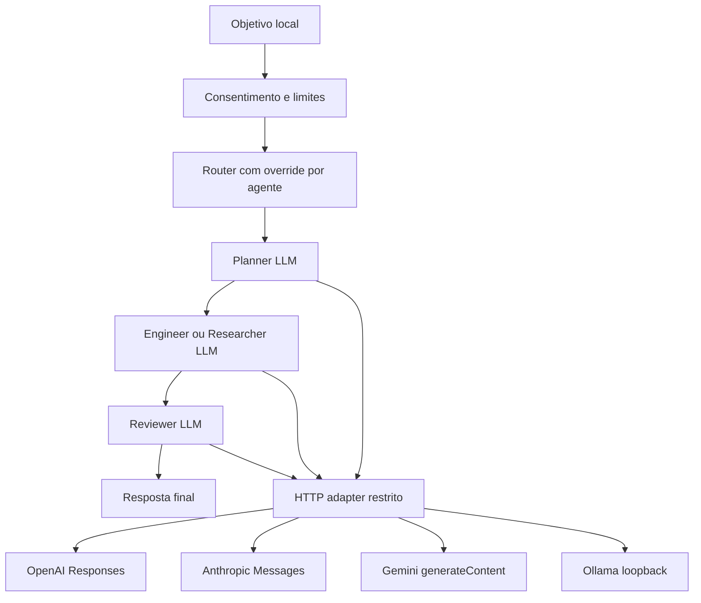

# Arquitetura atual

O runtime real (`harness/live.py`) é **sequencial** e somente de texto. Tem até cinco agentes e cinco chamadas por execução, conta tokens retornados se disponíveis, mas não garante preço/limite monetário. `harness/providers.py` não habilita tool calling, downloads, shells nem escrita em disco. Roteamento por função pode escolher provedores distintos; não há paralelismo. LLMs não possuem capacidade operacional sobre o repositório.

A foundation `harness/core.py` continua fornecendo contratos, política demonstrativa fail-closed, trace mínimo e simulação offline. A política demonstrativa não é mecanismo de aprovação autenticada. Protocolo MCP e A2A, memória persistente, sandbox, orquestração durável e autoevolução são **propostas não implementadas**.

## Evolução arquitetural
Prioridades: testes de qualidade com holdout, quotas/custos, checkpoints transacionais, sandbox e ferramentas read-only com permissões verificadas. A2A faz sentido para agentes remotos independentes; para delegação local o runtime pode ser simples. Não exponha scripts de Skills como ferramentas sem revisão e isolamento.

Veja [PROVIDERS.md](PROVIDERS.md), [STATUS.md](STATUS.md), [SECURITY.md](SECURITY.md), [EVOLUTION.md](EVOLUTION.md).
