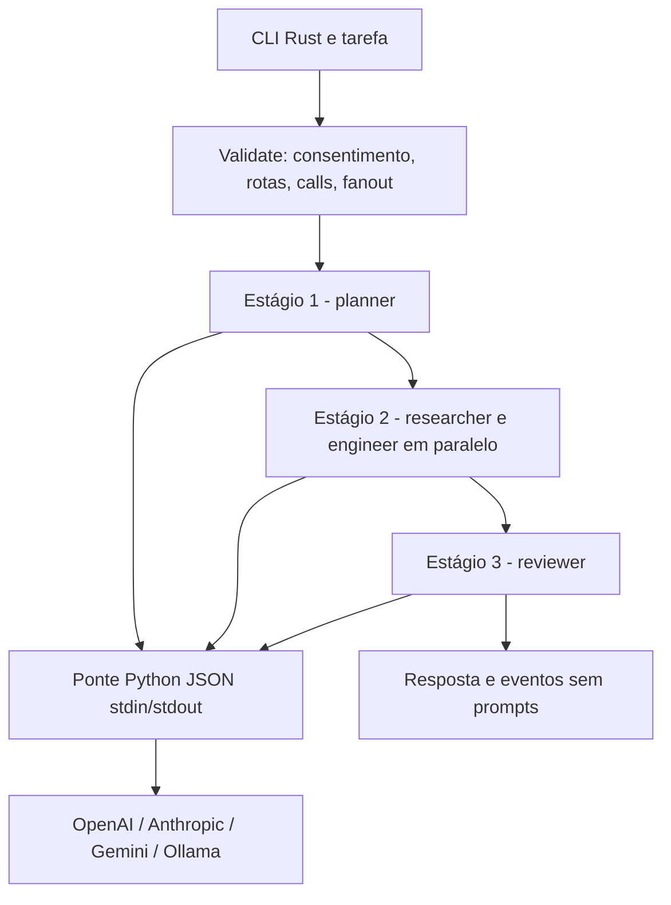

# Arquitetura Rust-first (estado atual)

**Rust é o dono do runtime:** plano tipado, limites, fan-out concorrente Tokio, ordenação determinística, validação prévia, política fail-closed e eventos.

**Python é o adaptador de IA:** ponte por subprocesso fixo `python3 -m harness.bridge`, chamando os provedores HTTP existentes. O código Python permanece acessível para experimentos, mas a CLI recomendada é a de Rust. O antigo CLI Python existe por compatibilidade.

**Skills e agentes:** os 7 papéis têm documentação individual; no runtime Rust os nomes são validados e a ponte Python fornece instruções dos papéis. As 9 Skills são arquivos portáveis, não são automaticamente carregadas. Não há execução de scripts das Skills.

**Segurança:** nenhum acesso a sistema de arquivos/shell por modelos, nenhum token de ferramenta, nenhum conector MCP/A2A conectado. O subprocesso Python é código local confiável, **não** é isolamento de SO. Respostas anteriores são dados não confiáveis em prompts. Limites de chamadas não garantem teto de custo.

**Próxima fase:** orçamento de tokens/custo, persistência, evals de qualidade, ferramentas read-only autorizadas e isolamento antes de escrita.

Detalhes: [RUST_CORE.md](RUST_CORE.md), [STATUS.md](STATUS.md), [PROVIDERS.md](PROVIDERS.md).
