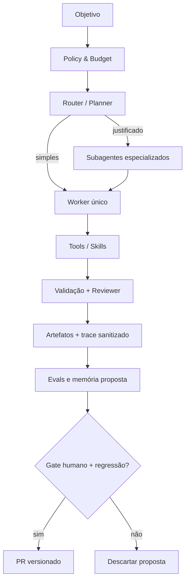

# Arquitetura

## Componentes
- **Orquestrador**: objetivo, limites, seleção, aprovações, agregação e erros.
- **Workers**: agentes especializados com entradas/saídas tipadas.
- **Skills**: instruções e scripts carregáveis sob demanda.
- **Adapters**: LLM, ferramentas, MCP/A2A, armazenamento e sandbox.
- **Policy engine**: autorização externa ao modelo; fail closed.
- **Telemetry**: traces com mínimo necessário; sem prompt completo por padrão.
- **Evals**: roteamento/política (offline); desempenho real exige benchmark adicional.
- **Evolution loop**: proposta -> experimento -> revisão -> promoção manual.

## Fluxo

## Padrões multiagente
- **Single agent**: padrão inicial.
- **Manager + agents-as-tools**: manager mantém titularidade da tarefa e agrega resultados.
- **Handoff**: especialista assume responsabilidade; requer transferência explícita de contexto/escopo.
- **Parallel fan-out**: apenas subtarefas independentes, com concorrência, tempo e gasto limitados.
- **Sequential deterministic**: integrações críticas, deploy, compliance e workflows repetíveis.
- **Evaluator-optimizer**: offline, limitado por benchmarks e revisão; sem loop recursivo ilimitado.

## Contratos obrigatórios antes da produção
Idempotency keys em ferramentas de escrita; isolamento por tenant; cancellation; timeouts; retries com backoff; checkpoint persistente; quotas/tokens/custos; autenticação e consentimento de tools; versões e schema de cada artifact; observabilidade estruturada; proteção contra prompt injection; avaliações de segurança.

## O que a demo NÃO faz
Não chama LLM, executa shell, acessa MCP, comunica A2A, lança threads, persiste checkpoints, nem altera arquivos. A demonstração ensina contratos e gates com execução reproduzível.
